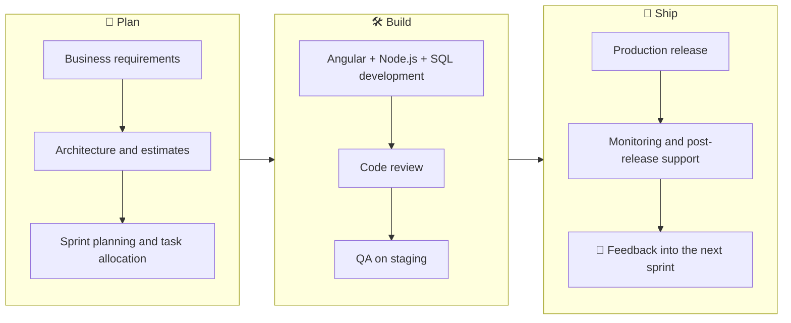

  

  

  
  
  
  

  
  
  

---

## 👨‍💻 About Me

I work in **Product Management & Development** and I'm a **Senior Full-Stack Developer** with **7+ years of experience** building web applications and business-focused digital products.

At **[ZarklyX](https://zarklyx.com/)**, I work in Product Management & Development for an all-in-one agency management and operations SaaS platform that covers CRM, client portals, project management, HR and payroll, invoicing, and social media management. I work across the product lifecycle, from architecture and sprint planning to implementation, code reviews, and releases.

I stay hands-on with engineering while helping teams work effectively. I focus on maintainable code, practical technical decisions, better development workflows, and software that solves real business problems.

**My core stack:** Angular, TypeScript, Node.js, Express, MySQL, and SQL.

- 🔭 Currently in **Product Management & Development at ZarklyX**, focused on product planning and technical delivery.
- 💼 Previously a **Senior Web Developer at KERYAR**, where I also headed the industrial internship program and mentored interns.
- 🏗️ Experienced in full-stack development, API architecture, database design, and deployment.
- 👥 Interested in engineering leadership, mentoring, and building high-performing development teams.
- 🗣️ Languages: English, Hindi, and Gujarati.
- 📍 Anand, Gujarat, India.

## ⚡ At a Glance

  

## 🧭 Career Journey

  

<b>View experience details</b>

 

| Period | Role | Organization | Highlights |
|---|---|---|---|
| **Present** | Product Management & Development | [ZarklyX](https://zarklyx.com/) | Product development for an agency management SaaS platform: architecture, sprint planning, task allocation, code reviews, and release coordination. |
| **From Feb 2021** | Senior Web Developer | [KERYAR](https://keryar.com/), Anand | Angular frontends; Node.js and SQL backends; server management on Hostinger and GoDaddy; Git, GitHub, and GitLab workflows; **headed the industrial internship program** and supervised the intern team. |
| **Aug 2020 – Oct 2020** | Web Developer | [SysTrack Solution Pvt. Ltd.](https://www.sys-track.com/), Vadodara | Angular front-end development, responsive design, performance optimization, testing and debugging, code reviews, and collaboration with UI/UX designers. |
| **Oct 2018 – Apr 2019** | Web Developer (Intern) | [ScrumBees Technologies](http://www.scrumbees.com), Vadodara | Responsive pages in HTML, CSS, and JavaScript; company website maintenance; testing, bug fixing, and cross-browser compatibility. |

## 🚀 What I Work On

- **Frontend Development:** Angular, TypeScript, JavaScript, responsive interfaces, reusable components, and UI integration.
- **Backend Development:** Node.js, Express, REST APIs, authentication, and business logic.
- **Databases:** MySQL, PostgreSQL, SQL queries, schema design, and data management.
- **Product Engineering:** Translating business requirements into practical, maintainable software.
- **Project & Technical Leadership:** Architecture discussions, sprint planning, task allocation, code reviews, mentoring, and release coordination.
- **Delivery & Operations:** Git, GitHub, GitLab workflows, CI/CD, staging and production environments, server management, and deployments.

## 🏗️ How I Build

  

## 🔄 How I Ship

## 🛠️ Tech Stack

**Frontend**

**Backend & Databases**

**Tools & Platforms**

**Integrations & Hosting**

## 💡 Product & Project Experience

I've worked on web products across different business domains, including:

| Domain | Experience |
|---|---|
| SaaS & Business Software | Agency management, CRM and ERP-style platforms, client portals, multi-role admin panels, payroll workflows, and operational dashboards |
| Education | School management systems and institutional websites |
| Commerce & Bookings | E-commerce experiences, booking systems, and customer-facing portals |
| Industry Platforms | Metal trading workflows and business operations software |
| Websites & Integrations | Responsive websites, third-party APIs, payment, email, and document-generation integrations |

Some of the products and organizations I've worked with include **ZarklyX, KERYAR, Flareo Payroll, Metalvyapar, Nextgen Metals, Arise Solar, Shree Sharda Kelavani Mandal, and [FOSTER X](https://fosterx.co/)**.

Not all of this work is open source or public, so this is a high-level overview, not a list of repositories.

## 🧠 My Engineering Principles

- **Maintainability first:** Write clear code and build architecture that fits the product.
- **Ownership:** Think beyond implementation. Testing, code reviews, deployment, and post-release support matter too.
- **Teamwork:** Encourage clear Git practices, useful reviews, realistic planning, and shared ownership.
- **Continuous improvement:** Keep learning and improve tools and workflows as products evolve.

## 🎓 Education

| Year | Qualification | Institution |
|---|---|---|
| 2019 | **Bachelor of Engineering, Computer Science** | KJ Institute of Engineering and Technology, Gujarat Technological University |
| 2016 | **Diploma, Computer Engineering** | Balasinor College of Polytechnic, Gujarat Technological University |

## 📊 GitHub Statistics

  
  

  

  

  <picture>
    <source media="(prefers-color-scheme: dark)" srcset="https://raw.githubusercontent.com/ptlshubham/ptlshubham/output/github-snake-dark.svg" />
    <source media="(prefers-color-scheme: light)" srcset="https://raw.githubusercontent.com/ptlshubham/ptlshubham/output/github-snake.svg" />
    
  </picture>

---

### 🤝 Let's Connect

I'm always happy to exchange ideas about product engineering, Angular, Node.js, scalable web applications, and engineering leadership.

- 🌐 Portfolio: https://ptlshubham.github.io/
- 💼 LinkedIn: https://www.linkedin.com/in/shubham-patel-bb5810b0/
- 💻 GitHub: https://github.com/ptlshubham
- 📧 Email: ptlshubham@gmail.com

  

