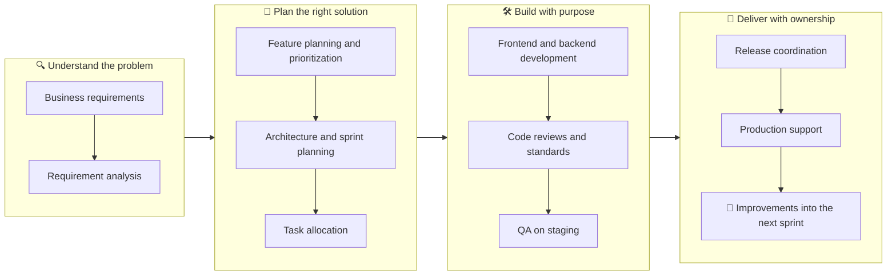

  

  

  
  
  
  

  
  
  

---

## 👨‍💻 About Me

I'm Shubham Patel, a **Product Management & Development** professional with **7+ years of experience** building web applications, managing product development, and delivering business-focused digital solutions.

I bridge product thinking and hands-on engineering to turn business ideas into scalable digital products. I work across the complete product lifecycle, from understanding business requirements and planning features to technical architecture, development, team coordination, and delivery.

At **[ZarklyX](https://zarklyx.com/)**, I take ownership of product management and development, connecting business requirements with technology to build scalable, maintainable software products. Coming from a strong software engineering background, I understand both sides of product development: what a business needs from a product, and how to build it.

- 🏢 **Current company:** ZarklyX
- 🧰 **Core technologies:** Angular · Node.js · TypeScript · MySQL · SQL
- 🔌 **Also work with:** API integrations, database architecture, authentication, payment gateways, deployment environments, and CI/CD workflows
- 👥 **Mentoring:** Guided developers and headed the industrial internship program at KERYAR
- 🗣️ **Languages:** English, Hindi, and Gujarati
- 📍 **Location:** Anand, Gujarat, India

> **My philosophy:** Understand the problem. Plan the right solution. Build with purpose. Deliver with ownership.

## ⚡ At a Glance

  

## 💼 Current Role

### Product Management & Development · [ZarklyX](https://zarklyx.com/)

**Product planning · Development · Engineering execution · Delivery**

I lead and contribute to the complete product lifecycle, connecting business objectives with technical solutions and coordinating product development from initial requirements through production delivery.

| Area | Key responsibilities |
|---|---|
| 🧭 **Product** | Manage product requirements and turn business needs into actionable development plans · Plan product features, development priorities, and sprint activities |
| 🛠️ **Engineering** | Coordinate frontend and backend development · Shape technical architecture and choose the right development approach · Maintain code quality through development standards and code reviews |
| 👥 **Team** | Manage development teams, task allocation, and delivery timelines · Work with clients and team members to resolve requirement and delivery challenges |
| 🚀 **Delivery** | Coordinate product releases across staging and production · Improve development workflows, Git practices, and CI/CD processes · Own product improvements, technical issues, and development execution |

**Stack:** `Angular` `TypeScript` `Node.js` `Express.js` `MySQL` `SQL` `Git` `CI/CD`

## 🧭 Career Journey

  

<b>View previous experience</b>

#### Senior Web Developer · [KERYAR](https://keryar.com/) · From Feb 2021

- Developed and maintained scalable web applications using Angular and JavaScript.
- Built frontend interfaces and backend functionality using Node.js and SQL.
- Developed business-oriented applications and client-specific solutions.
- Integrated third-party APIs, payment gateways, and email services.
- Managed hosting, server configurations, and application deployments.
- Maintained GitHub and GitLab repositories and development workflows.
- Guided developers and industrial interns on development activities.

#### Web Developer · [SysTrack Solution Pvt. Ltd.](https://www.sys-track.com/) · Aug 2020 – Oct 2020

- Developed responsive web application interfaces.
- Implemented frontend components using Angular and JavaScript.
- Converted UI designs into functional web pages.
- Worked on debugging, performance improvements, and application maintenance.

#### Web Developer Intern · [ScrumBees Technologies](http://www.scrumbees.com) · Oct 2018 – Apr 2019

- Developed responsive websites using HTML, CSS, and JavaScript.
- Assisted with web application development and maintenance.
- Implemented frontend requirements and UI enhancements.
- Collaborated with developers to troubleshoot and resolve technical issues.

## 🧩 Skills & Expertise

  

<b>View skills as text</b>

 

| Category | Skills |
|---|---|
| **01 · Product Management & Strategy** | Product Planning · Requirement Analysis · Feature Planning · Product Lifecycle Management · Business Requirement Understanding · Task Prioritization · Sprint Planning · Delivery Coordination · Release Planning · Stakeholder Communication |
| **02 · Project & Team Management** | Team Leadership · Task Allocation · Team Coordination · Development Planning · Code Review Management · Progress Tracking · Project Execution · Problem Solving · Developer Mentoring |
| **03 · Frontend Development** | Angular · Angular Standalone · TypeScript · JavaScript · HTML5 · CSS3 · SCSS · Bootstrap 5 · ng-bootstrap · ng-select · CKEditor 5 · ApexCharts · FullCalendar · Swiper |
| **04 · Backend & Database** | Node.js · Express.js · REST APIs · PHP · MySQL 8 · PostgreSQL · SQL · Prisma · JWT Authentication · Database Design · Query Optimization |
| **05 · DevOps & Infrastructure** | Git · GitHub · GitLab · CI/CD · PM2 · Linux VPS · Hostinger · GoDaddy · Server Management · Staging & Production · Deployment Management |
| **06 · Integrations & Services** | Razorpay · Firebase · Google reCAPTCHA · Facebook SDK · Nodemailer · PHPMailer · PDFKit · SMTP Integration · Payment Gateway Integration · Third-party APIs |

## 🛠️ Tech Stack

**Frontend**

**Backend & Databases**

**DevOps & Tools**

**Integrations & Hosting**

## 🏗️ How I Build

  

## 🔄 How I Work

## 🚀 Featured Projects

<table>
<tr>
<td width="50%" valign="top">

### 🏢 [ZarklyX](https://zarklyx.com/)
**Agency Operations Platform** · _Current product_

An integrated agency operations platform that brings multiple business workflows into one ecosystem: CRM, project management, social media, HR, payroll, accounting, SEO, analytics, and client portals.

**My role:** Product Management & Development. Requirements, development planning, technical direction, team coordination, and delivery.

`Angular` `Node.js` `SQL`

</td>
<td width="50%" valign="top">

### 💸 Flareo Payroll
**Multi-tenant payroll SaaS**

A multi-tenant Canadian payroll SaaS platform for managing payroll administration and employee workflows.

**My role:** Full-stack development. Frontend implementation, backend services, authentication, and database integration.

`Angular 20` `Bootstrap 5` `Express 4` `MySQL 8` `JWT` `PDFKit`

</td>
</tr>
<tr>
<td width="50%" valign="top">

### 🏭 Metalvyapar & Nextgen Metals
**Metal trading platforms**

Business-focused solutions for metal trading operations, customer management, and trading workflows.

**My role:** Web development, business workflow implementation, and frontend and backend functionality.

`Angular` `Node.js` `MySQL`

</td>
<td width="50%" valign="top">

### 🎓 Shree Sharda Kelavani Mandal
**Education**

Educational institution website and web-based functionality supporting institutional communication and digital presence.

**My role:** Web application development, frontend implementation, backend integration, and website maintenance.

</td>
</tr>
<tr>
<td width="50%" valign="top">

### 🛒 E-commerce & Booking Platforms
**Commerce and services**

Customer-oriented web applications for online shopping, service bookings, and management workflows.

**My role:** Application development, responsive interfaces, API integration, and database management.

</td>
<td width="50%" valign="top">

### ☀️ Arise Solar & Other Business Websites
**Business websites**

Digital experiences and responsive websites for businesses across different industries.

**My role:** Frontend development, website functionality, integrations, and deployment.

</td>
</tr>
</table>

Other work includes the [FOSTER X](https://fosterx.co/) web application and websites for education, real-estate, construction, and manufacturing businesses; see the [portfolio](https://ptlshubham.github.io/#projects). Most of this work is for clients and isn't open source, so these are summaries rather than links to public repositories.

## 🧠 Principles

- **Clear requirements first:** Successful products start with understanding the real problem.
- **Practical planning:** Prioritize what matters and plan realistic, deliverable sprints.
- **Maintainable engineering:** Write clear code and build architecture that fits the product.
- **Ownership:** Think beyond implementation. Testing, code reviews, deployment, and post-release support matter too.
- **Continuous improvement:** Keep improving tools, workflows, and Git practices as products evolve.

## 🎓 Education

| Year | Qualification | Institution |
|---|---|---|
| 2019 | **Bachelor of Engineering, Computer Science** | KJ Institute of Engineering and Technology, Gujarat Technological University |
| 2016 | **Diploma, Computer Engineering** | Balasinor College of Polytechnic, Gujarat Technological University |

## 📊 GitHub Statistics

  

  

  <picture>
    <source media="(prefers-color-scheme: dark)" srcset="https://raw.githubusercontent.com/ptlshubham/ptlshubham/output/github-snake-dark.svg" />
    <source media="(prefers-color-scheme: light)" srcset="https://raw.githubusercontent.com/ptlshubham/ptlshubham/output/github-snake.svg" />
    
  </picture>

Stats are generated daily by this repository's own GitHub Action, so they don't depend on any third-party stats service.

---

## 🤝 Let's Build Something Meaningful

I'm always interested in discussing innovative product ideas, exploring technology solutions, connecting with professionals, and collaborating on meaningful digital products.

Whether you're planning a new product, looking for technical guidance, or exploring development opportunities, let's connect and turn ideas into solutions.

- 🌐 **Portfolio:** https://ptlshubham.github.io/
- 💼 **LinkedIn:** https://www.linkedin.com/in/shubham-patel-s07/
- 💻 **GitHub:** https://github.com/ptlshubham
- 📧 **Email:** ptlshubham@gmail.com

  

